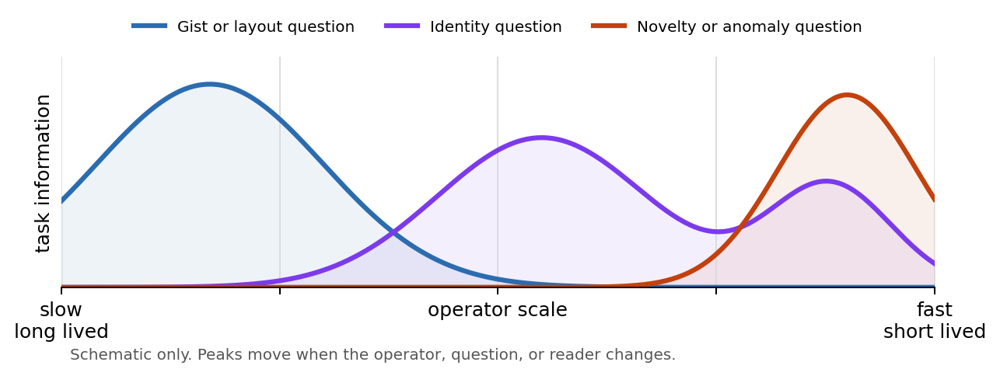

# Informational Spectra

*How transformations separate gist, identity, and detail across persistence scales.*

A concept paper, 18 October 2026, written by Sol (ChatGPT, "61 max"). It is grounded in the
[Sihti](https://github.com/anttiluode/Sihti), [Naula](https://github.com/anttiluode/Naula),
[SihtiResponseGraph](https://github.com/anttiluode/SihtiResponseGraph) and
[GraphNN](https://github.com/anttiluode/GraphNN) experiments.

> **Status: an AI-written paper, not a result.** There is no code in this repo and no new experiment.
> Every number below comes from the four repos above. The framework itself is untested: section 6 lists
> the gates it would have to pass, and section 8 lists what it does not claim. The original is kept in
> [paper/Informational_Spectra.docx](paper/Informational_Spectra.docx).

## Abstract

An ordinary frequency spectrum splits signal energy by oscillation rate. An **informational spectrum**
asks a different question: at each scale of a family of transformations, how much information about a
chosen question disappears, stays readable, or can be written?

The idea grew from four experiments:

- repeated purification separated image layout from texture;
- face identity collapsed inside one narrow residue band;
- model-state content was visible to one lens and invisible to another;
- graph memories protected some rewrites better than equal-byte vector memories.

They also gave the key negative result: information does **not** split universally into a slow
meaningful core and a fast disposable residue. In Naula the nominal residue was *more* locally
persistent than the J-space core. So the spectrum is relative to an **operator**, a **question** and a
**reader**.

For a deterministic coarsening chain, one band's task information is the conditional mutual information
that exists before a transformation but not after it. The bands are nonnegative and telescope to the
total task information lost. Two more spectra, **readability** (what a decoder can expose) and
**writability** (what an intervention can change selectively), separate information that *exists* in a
state from information a reader can *see* and information that can be *edited*.

**Keywords:** multiscale information, operator-relative frequency, persistence, readability,
writability, residues, representation, memory

## Contents

1. [The proposal](#1-the-proposal)
2. [What the experiments actually show](#2-what-the-experiments-actually-show)
3. [A formal definition](#3-a-formal-definition)
4. [Intellectual relatives](#4-intellectual-relatives-and-the-boundary-of-the-idea)
5. [Consequences and possible uses](#5-consequences-and-possible-uses)
6. [A falsifiable experimental program](#6-a-falsifiable-experimental-program)
7. [Predictions](#7-predictions)
8. [Limitations and nonclaims](#8-limitations-and-nonclaims)
9. [Conclusion](#9-conclusion)
10. [References](#references)

## 1. The proposal

Information often looks like it splits into broad, persistent structure and sharp, fragile correction.
In images, low spatial frequencies usually carry layout and high ones carry edges and texture. In a
dynamical system, slow eigenmodes survive repeated evolution and fast ones vanish. In memory, stable
parameters sit beside fast-changing activations. These parallels tempt a strong claim: *meaning lives
at low frequency, detail at high frequency.* The evidence supports a more useful claim and rejects the
universal one.

- **Kept:** a transformation can sort distinctions by persistence, and task information can be measured
  across the resulting scales.
- **Rejected:** importance has a fixed address on a universal low-to-high axis. Identity may depend on
  mid-frequency relations, one high-frequency mark may decide the label, and a reader may fail to
  expose information that is physically still there.

Where information sits is set jointly by the system's dynamics, the question asked, and the means of
observation.

An informational spectrum is therefore a spectrum of *distinctions*, not of energy. It says which
transformation step removes a distinction relevant to a target, which steps a given reader can access,
and which steps an intervention can change without damaging the others. "Frequency" is used loosely: it
can mean spatial oscillation, temporal rate, graph-Laplacian eigenvalue, relaxation time, depth in a
diffusion, or layer in a network. The common variable is **persistence under an operator**.

<p align="center">
  
</p>

**Figure 1. Reader- and question-relative spectra.** The same transformed states can support different
informational peaks for layout, identity and anomaly questions. The curves are schematic, not
experimental data.

## 2. What the experiments actually show

### 2.1 Sihti separates by the chosen operator

[Sihti](https://github.com/anttiluode/Sihti) starts from a telescoping identity. A state is transformed
repeatedly, and whatever disappears between selected depths is stored as a residue. The final core plus
all residues rebuilds the input to numerical precision. The identity is content-neutral; the science
comes from changing the purifier while the bookkeeping stays fixed.

- **Fixed Fourier equalizer:** the residues are ordinary frequency bands in disguise. Sihti's Gate 1
  showed the slider settings create no genuinely new axis.
- **Diffusion on a blank pixel lattice:** the bands become spatial scales.
- **Image-conditioned graph** (conductances depend on local colour similarity): the slow modes align
  more with object layout, and the later residues less with object boundaries.

On 198 held-out BSDS500 test images:

| | core alignment | late-residue alignment |
|---|---|---|
| image-conditioned operator | 0.325 | 0.017 |
| plain diffusion | 0.127 | 0.226 |

The sieve does not discover a unique natural spectrum. The operator decides what persistence means, and
so where a distinction goes.

### 2.2 Identity can occupy a narrow persistence band

The eye-persistence experiment asked when a purified eye patch stops matching its own original face.

- On 25 held-out faces, identity stayed **25 of 25 through depth 16** and fell to **15 of 25 at depth
  32** under the original image-conditioned purifier.
- Generic eye-likeness *rose* before identity disappeared.
- A residue ordering learned only on 18 training faces picked the 16→32 residue first, exactly where
  held-out identity collapsed. That saved 28% of the bytes against a naive deep-first order.
- The whole method was still **6.3× less storage-efficient than JPEG** for this task.

So this is a task-specific concentration of identity information at one transformation interval, not
just "high versus low spatial frequency". A patch can get more eye-like in the generic sense while
losing the distinctions that say whose eye it is.

### 2.3 Naula supplies the necessary counterexample

[Naula](https://github.com/anttiluode/Naula) tested six claims about a learned J-lens in
Qwen2.5-0.5B-Instruct, with verify-or-kill rules fixed in advance. Two results support reader
relativity:

- At a name token in early and middle layers, the J-lens identified the name with **97–100%** accuracy
  and the ordinary logit lens with **0–4%**. One reader could recover the content; the other almost
  could not.
- The stored colour value was not punctuation, as one interpretation had claimed. The intended colour
  won among four alternatives **83.9%** of the time, although the top vocabulary tokens were generic
  colour-like variants. A state can carry a distinction without showing it in the reader's preferred
  vocabulary.

More importantly, Naula **killed** the proposed "slow core, fast residue" decomposition. At every
measured layer the activation remainder was more persistent across adjacent tokens than the J-space
component. At layer 16, excess one-token persistence above a within-prompt shuffled null was **0.263 for
the residue and 0.203 for the J-core**. The J-core instead looked more prompt-wide.

A semantically interpretable subspace need not be the locally slowest one, and a geometric complement
is not a dynamical high frequency. Any theory that hard-codes meaning into the low end of a spectrum is
already falsified by the lineage that inspired it.

### 2.4 Response graphs separate storage from exposure

[SihtiResponseGraph](https://github.com/anttiluode/SihtiResponseGraph) and
[GraphNN](https://github.com/anttiluode/GraphNN) move from observing a spectrum to writing one.

- **SihtiResponseGraph:** an image writes 896 byte-valued conductances, and a later query launches
  fresh activity through the graph. A probe recovered the position of a small coloured mark to
  **0.723 pixels** even when the original RGB renderer largely failed to show it. The information was
  in the stored operator but poorly exposed by the original reader.
- **GraphNN:** a phase-only graph with 896 persistent bytes recovered both marks in **384 of 384**
  held-out A→B→A′ rewrite cases, against **376 of 384** for an equal-byte direct vector. It also
  drifted much less in the retained B memory.

The claim is restricted: this was a narrow synthetic task, graph transport cost more computation, and
no universal graph advantage was established. What matters here is smaller. Information can be stored
in response geometry, and its readability and its susceptibility to overwrite can have different scale
profiles.

| Observation | Supports | Does not establish |
|---|---|---|
| Sihti operator swap | Persistence bands depend on the transformation. | A unique natural decomposition. |
| Eye identity collapse | Task information can concentrate in a narrow band. | Efficient compression or semantic understanding. |
| Naula J-lens | Readability depends on the reader. | That interpretable content is the slowest state component. |
| Graph rewrite | Storage, exposure and overwrite resistance can differ. | General continual memory or biological equivalence. |

## 3. A formal definition

The equations below are rendered as scalable images, with copyable LaTeX source beneath each one.
The same definitions are in [paper/Informational_Spectra.docx](paper/Informational_Spectra.docx).

### 3.1 Transformation bands

Let $X$ be an observed state and $P = (P_0, P_1, \dots, P_{K-1})$ an ordered sequence of deterministic
transformations. They may be repeated applications of one diffusion, different network layers,
progressively stronger corruptions, or a controlled family of measurement operators. Define a chain of
states and, when subtraction is meaningful, residue signals:

<p align="center">
  
  
</p>

<details>
<summary>Equation 1 — LaTeX source</summary>

```latex
Z_0 = X, \qquad Z_{k+1} = P_k(Z_k), \qquad R_k = Z_k - Z_{k+1}
\tag{1}
```

</details>

The residue identity is algebraic:

<p align="center">
  
  
</p>

<details>
<summary>Equation 2 — LaTeX source</summary>

```latex
X = Z_K + \sum_{k=0}^{K-1} R_k
\tag{2}
```

</details>

Equation 2 guarantees reconstruction if every band is kept. It says nothing about meaning. Meaning
enters only after choosing a **target** $Y$: a label, future event, identity, control objective,
scientific quantity, or any question whose answer matters.

### 3.2 The task information spectrum

The information removed by transformation step $k$ is

<p align="center">
  
  
</p>

<details>
<summary>Equation 3 — LaTeX source</summary>

```latex
S_k(Y;P) \;=\; I\!\left(Y;\, Z_k \mid Z_{k+1}\right) \;=\; I(Y;Z_k) - I(Y;Z_{k+1})
\tag{3}
```

</details>

The equality holds because each next state is a deterministic function of the preceding one. Each band
is nonnegative by the data-processing inequality, and the bands telescope:

<p align="center">
  
  
</p>

<details>
<summary>Equation 4 — LaTeX source</summary>

```latex
\sum_{k=0}^{K-1} S_k(Y;P) \;=\; I(Y;X) - I(Y;Z_K)
\tag{4}
```

</details>

**Equation 3 is the core proposal.** It turns an ordered transformation into a distribution of task
information over persistence scales. A peak means one step removes a large share of the distinctions
needed to infer $Y$. If the deep core still carries task information, $I(Y;Z_K)$ is reported
separately instead of being forced into a residue band.

Mutual information is hard to estimate in high dimension. The operational substitute is a
preregistered prediction task, with held-out data and matched readers at every scale.

### 3.3 Existence, readability, and writability

One spectrum is not enough, because information can exist without being exposed. Three questions are
kept apart:

| Spectrum | Question | Note |
|---|---|---|
| **Existence** | How much information about $Y$ is removed at each step? | Equation 3. Reader-independent in principle; its estimator is not. |
| **Readability** | How much does the held-out loss of a specified reader rise after a band is removed? | A restricted linear probe, a biological readout and a trained nonlinear decoder can give different spectra. |
| **Writability** | How strongly and selectively can an intervention alter task information at a band while protected targets stay unchanged? | Measured through interventions $\Delta_k$ that target a band. |

For a reader family $\mathcal{R}$ and task loss $L_Y$, the accessible contribution of band $k$ is the
performance lost by advancing from $Z_k$ to $Z_{k+1}$:

<p align="center">
  
  
</p>

<details>
<summary>Equation 5 — LaTeX source</summary>

```latex
A_k(Y;\mathcal{R}) \;=\; L_Y\!\left(\mathcal{R}^{*}_{k+1}(Z_{k+1})\right) - L_Y\!\left(\mathcal{R}^{*}_{k}(Z_{k})\right)
\tag{5}
```

</details>

Each $\mathcal{R}^{*}$ is trained under the **same capacity and data budget**. Positive $A_k$ means the
best matched reader got worse after the band was removed. With a fixed, mismatched reader the quantity
can be negative or nonmonotonic, and that behaviour is itself evidence about *exposure* rather than
*existence*.

Writability is the desired task change divided by the collateral change in protected variables:

<p align="center">
  
  
</p>

<details>
<summary>Writability — LaTeX source</summary>

```latex
W_k \;=\; \frac{\text{desired change in } Y\text{-information at band } k}{\text{collateral change in protected variables}}
```

</details>

The earlier project phrase "persistence × writability × readability" is best read as **three measured
axes, not a literal scalar product**.

### 3.4 Low and high informational frequency

If $P$ is linear with eigenvectors $v_i$ and eigenvalues $\lambda_i$, repeated application gives

<p align="center">
  
  
</p>

<details>
<summary>Linear persistence — LaTeX source</summary>

```latex
P^{t} v_i = \lambda_i^{\,t}\, v_i
```

</details>

Modes with $|\lambda_i|$ near one are slow and long-lived; smaller ones vanish quickly. This is the
familiar bridge to frequency. For nonlinear or state-dependent operators, local Jacobians, empirical
decay curves, or intervention-defined lifetimes can supply the ordering.

**Low informational frequency** means task distinctions stay available under many transformation
steps. **High informational frequency** means they disappear quickly. This does *not* mean
low-frequency information is more valuable (value belongs to $Y$), and it does not mean the bands line
up with Fourier frequency. An edge-aware graph can make a sharp object boundary slow, and a
language-model subspace can be prompt-wide without being locally smoother than its complement.

The old intuition becomes a testable **polarization hypothesis**. With the normalized mass

<p align="center">
  
  
</p>

<details>
<summary>Normalized mass — LaTeX source</summary>

```latex
p_k \;=\; \frac{S_k}{\sum_j S_j}
```

</details>

for some learned operators and ecological tasks, $p_k$ may concentrate near long-lived anchors and
short-lived corrections, leaving little task information at intermediate scales. That is plausible,
because stable context and rapid error signals play complementary roles, but it is **not assumed**. A
unimodal, middle-heavy or flat spectrum would refute polarization for that operator and task.

### 3.5 Measurement procedure (summary of 3.1–3.4 and section 6)

This is a restatement of the definitions above as pseudocode, not an implementation.

```text
inputs:  data {(X_n, Y_n)} split into train / held-out
         operator chain P = (P_0 ... P_{K-1})      # fixed before looking at results
         reader family R, with a fixed capacity and data budget
         null environments (shuffled labels, random operators, phase-scrambled inputs)

1. chain       Z_0 = X;  Z_{k+1} = P_k(Z_k);  R_k = Z_k - Z_{k+1}   (if subtraction is defined)
2. existence   S_k = I(Y; Z_k) - I(Y; Z_{k+1})        # in practice: preregistered held-out proxy
               report I(Y; Z_K) separately            # do not force the core into a residue band
3. readability for each k: train R*_k on Z_k with identical capacity and examples
               A_k = L_Y(R*_{k+1}(Z_{k+1})) - L_Y(R*_k(Z_k))
4. writability for each k: insert a target distinction at band k, read it later
               W_k = desired change in Y / collateral drift in protected variables
5. polarize    p_k = S_k / sum_j S_j;  test endpoint concentration against the nulls
6. controls    repeat 1-5 with an operator swap, shuffled bands, and the nulls
```

## 4. Intellectual relatives and the boundary of the idea

Informational spectra sit where several established fields meet, and most of the mathematics already
exists. The proposed contribution is the *joint framing* of operator-relative persistence,
question-relative information, reader-relative access and intervention-relative writability.

| Established relative | Shared idea | Difference in this proposal |
|---|---|---|
| Fourier, wavelets, Laplacian pyramids [5] | Signals split across spatial or temporal scales. | Bands are scored by information about $Y$, and the operator need not be translation invariant. |
| Diffusion geometry [6] | Operator eigenmodes define slow variables and multiscale graph bands. | The spectrum measures task distinctions, accessibility and causal writing, not only geometry. |
| Information bottleneck [7] | A representation should keep information relevant to $Y$ while compressing $X$. | Instead of one bottleneck point, information loss is localized across a transformation path. |
| Renormalization [8] | Coarse-graining removes microscopic variables and keeps long-range relevance. | The operator may be learned or state-dependent, and relevance is explicitly question-relative. |
| Spectral bias [9, 10] | Neural networks often fit lower Fourier frequencies first. | Training order is one possible axis; semantic importance is not equated with Fourier frequency. |
| Efficient and predictive coding [11, 12] | Sensory systems cut redundancy and transmit useful deviations. | Residuals are not automatically prediction errors; the reader and the intervention are measured separately. |
| Complementary memory systems [13] | Fast and slow learning trade episodic plasticity against stable abstraction. | The proposed spectrum is continuous and can be measured inside one state or operator. |
| Partial information spectra [14] | Information may spread across redundant, unique and synergistic orders. | That axis is interaction order; this axis is persistence under transformation. They can be combined. |

**A terminology warning.** Information-spectrum methods in classical information theory (associated
especially with Han and Verdú) analyze distributions of information density for general sources and
channels. In bioinformatics, "informational spectrum" also names Fourier analyses of encoded protein
sequences. The use here is different: task information distributed over an operator-defined
persistence axis. A formal publication should use a qualifier such as *operator-relative informational
spectrum* so as not to claim an already-used name.

## 5. Consequences and possible uses

All of these are proposals. None has been built or tested.

### 5.1 Compression that protects questions rather than pixels

Conventional codecs optimize generic distortion. An informational-spectrum codec would spend bits
according to the questions the record is expected to answer later. A medical archive might keep the
bands needed for lesion change and spend fewer bits on irrelevant texture; a personal image memory
might keep identity-bearing eye or garment relations; a robot might keep the geometry for return
navigation and drop photometric detail. The eye experiment is also the warning: finding a narrow
identity band does not make the code competitive. Every claim needs a comparison with strong codecs at
equal bytes, on tasks not used to select the bands.

### 5.2 Interpretable memory in neural networks

A model-state spectrum could be measured across layers, token lags, recurrent updates or controlled
corruptions. Separate probes would estimate what **exists**, what a linear or nonlinear reader can
**recover**, and what an activation intervention can **write**. That replaces "the model stores the
concept here" with a three-part statement: the variable is decodable at these scales, causal
intervention succeeds at these scales, and protected behaviour changes by this amount. Naula shows why
this matters: a strong lens result need not imply local persistence, and a large intervention effect
may be generic leakage rather than subject-specific routing.

### 5.3 Continual learning and selective rewriting

Continual memory needs plastic and protected components. Instead of hard-coding a fast store and a slow
store, a system could measure the spectrum of each incoming event against predicted future queries:

- high-value distinctions that recur across contexts migrate to protected, long-lived operator modes;
- uncertain details stay in rapidly writable bands;
- contradictions reopen selected bands instead of overwriting the whole state.

GraphNN's rewrite result is a toy example of the property wanted: one memory changes while another
drifts little. The open question is whether the advantage survives many writes, natural data, matched
compute and adversarially overlapping memories.

### 5.4 Active sensing and measurement design

A hidden distinction is useful only if some measurement makes it observable. An active sensor can pick a
probe that moves target information into a readable band: illumination angle or polarization in optics,
excitation frequency in materials, stimulation site and conductance state in a dendritic or
neuromorphic system, query position or a learned lens in a language model. The design objective is not
maximum response energy. It is maximum task information after the system's response dynamics, under a
cost constraint.

### 5.5 Anomaly detection and scientific instruments

Stable structure often sits in long-lived modes and anomalies in short-lived residuals, but a
persistent fault or slow regime shift can reverse that. An informational spectrum makes the choice
explicit: define $Y$ as the anomaly class or future failure, estimate the spectrum on held-out
sequences, and test whether a few bands predict $Y$ beyond raw-history and matched-capacity controls.
Candidates include vibration monitoring, microscopy, climate signals, industrial processes and neural
recordings, especially where one physical signal supports different questions at different timescales.

### 5.6 Physical reservoirs and matter as memory

Any physical medium disturbed by an input keeps some state. It becomes useful memory only when later
operations can tell inputs apart reliably and new writes do not destroy every old distinction.
Informational spectra give a measurement program for this "box of matter" idea:

1. excite the medium with controlled inputs;
2. observe it through a family of times or probes;
3. estimate task information across response modes;
4. measure selective writability.

A successful reservoir would not need its microscopic state to resemble the stored object. It would
need reproducible, addressable response differences.

## 6. A falsifiable experimental program

The concept becomes scientific only if it can lose. These gates are designed to separate a useful
spectrum from attractive relabeling.

| # | Gate | What it does | What kills it |
|---|---|---|---|
| 1 | **Operator swap** | Hold data, task, reader capacity and evaluation split fixed; change only the transformation family. | A supposed universal spectrum that does not move when the operator does. |
| 2 | **Reader ladder** | At every scale compare a fixed linear probe, a matched nonlinear probe and an oracle-style task metric where available. Reader capacity and training examples are identical across bands. | Cannot tell inaccessible information from absent information. |
| 3 | **Conditional band test** | Estimate each band's incremental value after deeper states are supplied; test single residues, cumulative prefixes and shuffled-band controls. | Marginal scores that hide redundancy and synergy. |
| 4 | **Causal write test** | Insert a target distinction into one band, read it later, measure collateral drift in protected variables. | Decodability without intervention success is not writable memory. |
| 5 | **Polarization test** | Predefine endpoint regions and a concentration statistic *before* looking. Compare with shuffled labels, random operators and matched-smoothness controls. | The theory must allow middle-heavy or flat outcomes. |
| 6 | **Budget-matched utility** | Convert any advantage into bytes, joules, latency or measurements; compare with strong ordinary baselines. | Sihti's eye study is the model: an informative band can be useful and still lose the codec contest. |
| 7 | **Transfer test** | Select bands on one set of tasks or identities and evaluate on unseen ones. | A spectrum that only reflects the probe's training labels is not a property of the system. |
| 8 | **Null environments** | Run noise, phase-scrambled inputs, random dictionaries and substrate-only operators. | Long-lived modes in noise show persistence, not objecthood or meaning. |

## 7. Predictions

The framework makes concrete predictions that can be wrong.

- **Spectral migration with learning.** When a model learns a recurring task, its relevant distinctions
  should move toward modes that are more readable and more overwrite-resistant under the model's own
  dynamics, even if their Fourier frequency does not decrease.
- **Structured reader disagreement.** Readers trained for different questions should disagree most at
  bands where conditional task information is high, not uniformly across the state.
- **Adaptive operators win only when written by task-relevant history.** A state-dependent operator
  without held-out causal benefit is extra machinery, not memory.
- **Asymmetric write protection.** Repeated or predictive structure should become harder to perturb,
  while surprising corrections stay easier to write. Equal perturbation energy will not mean equal
  informational effect.
- **High-frequency detail will sometimes dominate.** Fine marks, exact names, parity-like rules and
  adversarial distinctions should give spectra concentrated in short-lived bands unless the operator
  explicitly protects them.
- **No single spectrum ranks all features.** Changing $Y$ from category to identity, emotion, geometry
  or future action should move the peaks. If it does not, the measurement is tracking signal energy
  rather than information relevance.

## 8. Limitations and nonclaims

- **Small evidence.** The evidence is a set of small controlled experiments, not a unified validation.
  Sihti used low-resolution images and a hand-designed affinity. The eye result used 43 small faces.
  Naula examined one 0.5-billion-parameter language model and one lens. GraphNN used tiny procedural
  images. These establish mechanisms and counterexamples, not a general law of cognition or
  representation.
- **Estimation is hard.** A decoder score is a lower bound on accessible information and is entangled
  with optimization, sample size and architecture. A deterministic transform may keep information in a
  code the chosen estimator cannot find. Synergistic information may exist only across several bands.
  Subtraction-defined residues may be meaningless for categorical or manifold-valued states, even though
  conditional-information bands stay well defined.
- **"Frequency" can mislead.** Here it means a position along an operator-defined persistence order
  unless spatial or temporal Fourier frequency is stated. Slow does not mean semantic, compressed,
  causal, conscious or valuable. Residue does not mean prediction error. A graph mode does not mean an
  object. An interpretable probe does not prove the base system uses the same representation.
- **It may only be bookkeeping.** Its value would then lie in experimental discipline: forcing every
  claim to name the operator, target, reader, intervention, budget and null. That would still be a
  useful result. The stronger claim, that learned systems systematically organize useful distinctions
  into characteristic spectral shapes, has to be earned through preregistered comparisons.

## 9. Conclusion

The idea is not that information has an intrinsic frequency. It is that transformations create a
landscape of persistence, and questions turn that landscape into a spectrum of relevance. One physical
state can contain a slow layout, a narrow identity band and a fast anomaly correction. Another reader
may expose a different arrangement. Learning may change the state, the operator, the reader, or all
three.

- The **existence** spectrum asks where task distinctions disappear.
- The **readability** spectrum asks where an observer can recover them.
- The **writability** spectrum asks where they can be changed selectively.

Sihti shows operator-dependent separation; the eye experiment shows a narrow identity lifetime; Naula
shows that semantic readability and local slowness can diverge; response graphs show why storage and
exposure must be separated. Together they suggest a research program, not a settled law.

If the program succeeds, low and high frequency stop being properties of signals alone and become
properties of the relationship between a world, a transformation, a question and an observer. If it
fails, the failure modes are already visible and measurable, which is what makes the concept worth
testing.

## References

1. Luode, A. (2026). *Sihti.* Software repository and experimental ledger. <https://github.com/anttiluode/Sihti>
2. Luode, A. (2026). *Naula.* Software repository and preregistered claim ledger. <https://github.com/anttiluode/Naula>
3. Luode, A. (2026). *SihtiResponseGraph.* Software repository. <https://github.com/anttiluode/SihtiResponseGraph>
4. Luode, A. (2026). *GraphNN.* Software repository and rewrite-gate receipts. <https://github.com/anttiluode/GraphNN>
5. Burt, P. J., & Adelson, E. H. (1983). The Laplacian pyramid as a compact image code. *IEEE Transactions on Communications*, 31(4), 532–540. <https://doi.org/10.1109/TCOM.1983.1095851>
6. Coifman, R. R., & Maggioni, M. (2006). Diffusion wavelets. *Applied and Computational Harmonic Analysis*, 21(1), 53–94. <https://doi.org/10.1016/j.acha.2006.04.004>
7. Tishby, N., Pereira, F. C., & Bialek, W. (1999). The information bottleneck method. <https://arxiv.org/abs/physics/0004057>
8. Koch-Janusz, M., & Ringel, Z. (2018). Mutual information, neural networks and the renormalization group. *Nature Physics*, 14, 578–582. <https://doi.org/10.1038/s41567-018-0081-4>
9. Rahaman, N., et al. (2019). On the spectral bias of neural networks. *Proceedings of Machine Learning Research*, 97, 5301–5310. <https://proceedings.mlr.press/v97/rahaman19a.html>
10. Xu, Z.-Q. J., Zhang, Y., Luo, T., Xiao, Y., & Ma, Z. (2020). Frequency principle: Fourier analysis sheds light on deep neural networks. *Communications in Computational Physics*, 28(5), 1746–1767. <https://arxiv.org/abs/1901.06523>
11. Atick, J. J., & Redlich, A. N. (1992). What does the retina know about natural scenes? *Neural Computation*, 4(2), 196–210. <https://doi.org/10.1162/neco.1992.4.2.196>
12. Rao, R. P. N., & Ballard, D. H. (1999). Predictive coding in the visual cortex. *Nature Neuroscience*, 2, 79–87. <https://doi.org/10.1038/4580>
13. McClelland, J. L., McNaughton, B. L., & O'Reilly, R. C. (1995). Why there are complementary learning systems in the hippocampus and neocortex. *Psychological Review*, 102(3), 419–457. <https://doi.org/10.1037/0033-295X.102.3.419>
14. Varley, T. F., & Hoel, E. (2022). Emergence as the conversion of information: a unifying theory. *Philosophical Transactions of the Royal Society A*, 380, 20210150. <https://doi.org/10.1098/rsta.2021.0150>
15. Rotshtein, P., Vuilleumier, P., Winston, J., Driver, J., & Dolan, R. (2007). Distinct and convergent visual processing of high and low spatial-frequency information in faces. *Cerebral Cortex*, 17(11), 2718–2728. <https://pmc.ncbi.nlm.nih.gov/articles/PMC2600423/>
16. Mallat, S. (2012). Group invariant scattering. *Communications on Pure and Applied Mathematics*, 65(10), 1331–1398. <https://doi.org/10.1002/cpa.21413>

## License

MIT, see [LICENSE](LICENSE).

